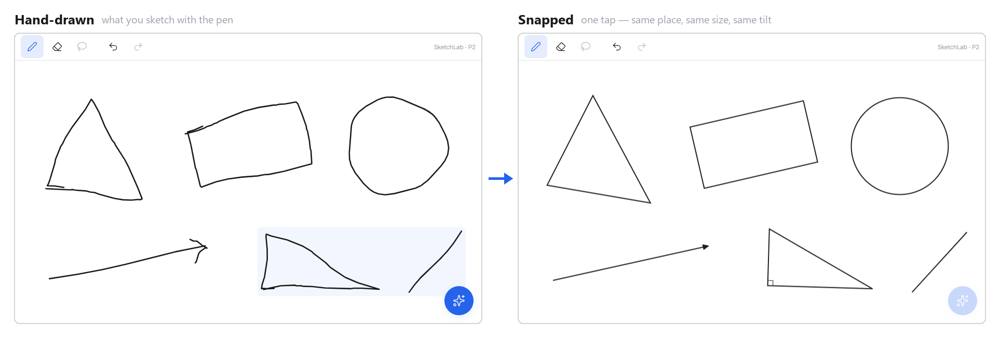
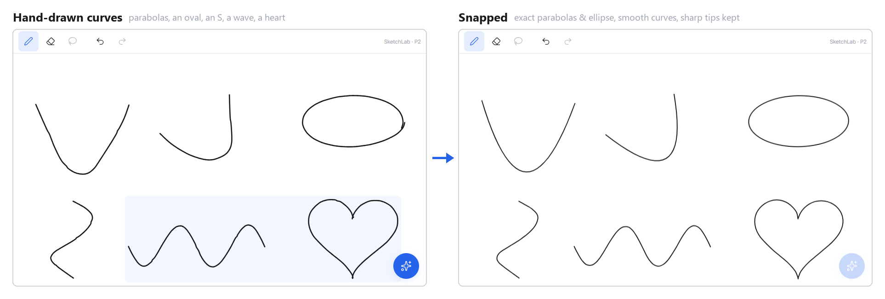

# SketchLab

**Sketch it rough with a pen; get a textbook-quality figure back, right where you drew it.**

[](https://github.com/kraewon7422/sketchlab/actions/workflows/ci.yml)
[](https://kraewon7422.github.io/sketchlab/)
[](LICENSE)





**▶ Try it: [kraewon7422.github.io/sketchlab](https://kraewon7422.github.io/sketchlab/)**. Draw a shape, then tap ✨ (or press <kbd>Enter</kbd>).
On a tablet, finish a stroke and hold the pen still for half a second: that stroke snaps on its own.

> 🇰🇷 [한국어 설명은 아래에 있습니다](#한국어)

---

## Why I made it

I take math and science notes by hand on a Galaxy Tab. Drawing a clean graph, a solid you can
rotate, or a chemical structure inside a notes app is slow, and the usual workaround (plotting in
Python and pasting the image) looks rough and isn't interactive at all.

SketchLab's goal is a tool that sits **next to the notes app** (split screen or pop-up window).
You sketch roughly, it turns the sketch into a precise, textbook-style figure, and you drag the
result into your notes. It runs in the browser, so the same tool works on a tablet, a phone and a PC.

## Status

Built in phases; each phase has acceptance criteria (automated tests plus a real-browser check)
that must pass before the next one starts. The full design is in the
[master spec](docs/MASTERSPEC_v4.md) (Korean).

| Phase | What | State |
|---|---|---|
| P0 | Monorepo, strict TypeScript, CI, HTTPS dev server | ✅ |
| P1 | Pen input: pressure, palm rejection, undo/redo, auto-grouping, local persistence | ✅ |
| P1.5 | S Pen polish: hover cursor, predicted points, side-button eraser, responsive layouts | ✅ |
| **P2** | **Local shape recognition (Tier 0): lines, arrows, polygons, circles, arcs, parabolas, ellipses, smooth curves** | ✅ **← the live demo** |
| P3a | Graph engine: textbook axes (1:1 scale, π ticks, dashed asymptotes), coefficient sliders, integrals | next |
| P3b | Handwriting → LaTeX / graphs via a vision model | planned |
| P4 | 3D solids and 3D coordinate space with smooth, inertial rotation and exact hidden lines | planned |
| P5 | Chemistry: structure recognition, validation and drawing (RDKit) | planned |
| P6 | Export into Samsung Notes / GoodNotes (drag & drop, clipboard, share sheet) | planned |
| P7 | Correction UI, offline PWA, share-to-SketchLab from notes apps | planned |

## How shape recognition works

Everything in the demo runs **locally in the browser**: no server, no network, about 0.1 ms per
shape on a desktop CPU.

```
pen strokes ──▶ classify each stroke ──▶ combine strokes ──▶ snap ──▶ Scene IR ──▶ SVG renderer
                line / arc / circle /      arrows, polygons    exact      (zod-validated,
                polygon / parabola /       drawn as 3 lines    90°, ...    versioned JSON)
                ellipse / smooth curve
```

1. **Resample by arc length.** Stored strokes are simplified (RDP), so straight parts have almost
   no points. Resampling evenly lets corners be measured over a fixed *fraction of the stroke length*,
   which makes every threshold scale-invariant: a tiny triangle and a huge one get the same answer.
2. **Find corners** as peaks of the turning angle, measured over a window on each side.
3. **Fit**: total-least-squares lines for edges (vertices = intersections of neighbouring edges,
   so corners come out sharp), and an algebraic (Kåsa) circle fit for round shapes.
4. **Curves.** A parabola is fitted in a rotated frame (any tilt) and stored as one quadratic Bézier —
   a parabola segment *is* a quadratic Bézier, so it is exact, not approximated; nearly symmetric ones become
   exactly symmetric. Elongated loops become ellipses (axis ratio and tilt kept). Everything else becomes a
   smooth Catmull-Rom curve with evenly spaced control points that keeps the drawn shape and only its truly
   sharp corners (a heart keeps its tips; a sine wave keeps round peaks).
5. **Combine and snap.** A triangle drawn as three separate lines becomes one triangle. Near-equal
   sides become an equilateral triangle; four near-right angles become a rectangle (or a square), keeping
   the **original tilt**. A near-right triangle gets an exact 90° corner *and* the right-angle mark.
6. **Leave handwriting alone.** A group of several small strokes that includes curves looks like writing,
   so nothing in it is touched: a half-straightened word is worse than the original. (Reading handwriting is
   a later phase.)

A few problems that only showed up with realistic, wobbly input, each now pinned by a test:

| Problem | Fix |
|---|---|
| Closing a shape, the pen overshoots the start; joining the ends creates two fake corners | Trim the stroke where it passes closest to its own start |
| A handwritten **S** has two sharp-ish bends and turned into a zigzag | A real corner turns almost as much over a short window as over a long one; a smooth bend doesn't (`sharpRatio`). A real corner also passes close to where its two edges meet; a bend cuts inside (`roundCut`) |
| Smoothed sine waves came out as "tents": straight sides, pointy peaks | Measured the short/long turn ratio: true corners ≥ 0.83, tight bends ≤ 0.63 → only ≥ 0.75 stays sharp inside curves; and control points are spaced evenly (uneven RDP points pinch Catmull-Rom curves) |
| Narrow U-shaped parabolas were filed as "curve" | Their tight vertex looks like a corner; when straight edges don't fit, try the parabola fit before falling back |
| Small, quickly drawn arrowheads are too shaky to read as a clean "V" | An unclassifiable stroke counts as an arrowhead only at the tip of a line and swept back along it; anywhere else it still rejects the group |
| On tiny strokes the measuring window shrank below hand jitter | Pixel minimums for both windows |

**Measured accuracy**: synthetic hand-drawn shapes with low-frequency wobble, jitter, random
rotation and size, and an over- or under-shot close; 8 seeds × 40 tries per shape:

| Circle | Line | Arrow | Ellipse | Parabola | Rectangle | Triangle |
|---|---|---|---|---|---|---|
| 100% | 100% | 100% | 100% | 98.8% | 99.4% | 99.1% |

Also: 198 / 200 hand-drawn arcs stay arcs (not parabolas), sharp V's stay V's (100 / 100), and
0 / 400 small handwriting groups ("2x=") are changed.

## Engineering notes

- **One contract between recognition and rendering.** Every recognized object is a *Scene IR*
  value, a [zod](https://zod.dev) discriminated union ([`shared/src/ir.ts`](shared/src/ir.ts)), so
  a mismatched `kind`/`data` pair can't get through. Coordinates are object-local and normalized,
  never canvas pixels. IR is versioned, and stored data from older versions is migrated
  ([`migrate.ts`](shared/src/migrate.ts)) and re-validated on load. Anything invalid falls back to
  the original ink rather than being lost.
- **Input at 120 Hz without jank.** Pointer events bypass React. The live stroke is updated by
  appending only the new segment to an SVG path each animation frame; the store is touched once
  per stroke. Coalesced events recover fast strokes, and predicted events reduce perceived latency
  without ever entering the saved stroke.
- **Crisp pressure-sensitive ink: one outline per stroke.** The first version drew each stroke as
  hundreds of overlapping quads and joint polygons; each piece is anti-aliased separately, and on a
  high-resolution tablet the seams looked blurry and pixelated. Now a stroke is a single closed path — a
  centripetal Catmull-Rom centerline (no overshoot on uneven point spacing), smoothed pressure,
  quadratic-Bézier sides and true arc end caps — rebuilt every frame while drawing (3000 points in a few ms).
- **Undo/redo via immer patches**; recognition is a single undo step that restores the exact original ink.
- **Design tokens only.** Every colour, size and duration comes from
  [`theme.ts`](client/src/render/theme.ts). Textbook visual language: 2 px `#1A1A1A` lines, no
  gradients or glow.

## Tech stack

TypeScript (strict) · React 19 · Vite · zustand + immer · zod · SVG (no chart libraries) ·
IndexedDB · Vitest · Playwright · GitHub Actions · npm workspaces (`shared/`, `client/`, `server/`)

The server package is a stub for now. In P3b it will keep the vision-model API key server-side;
the browser never sees a key.

## Run it locally

```bash
npm install
npm run dev          # https://localhost:5173, also exposed on your LAN for a tablet
```

| Command | What it does |
|---|---|
| `npm run dev` | Client dev server (HTTPS, reachable from a tablet on the same Wi-Fi) |
| `npm run ci` | Lint + typecheck + all tests |
| `npm test` | Unit tests only (Vitest) |
| `npm run build` | Production build → `client/dist` |

Opening the dev server from a tablet: use the `Network` address it prints, and accept the
self-signed-certificate warning once. HTTPS is needed because clipboard, share sheet and
`crypto.subtle` only work in a secure context.

## Project layout

```
shared/src/        Scene IR schema + migration (the contract)
client/src/
  ink/             pen input, palm rejection, stroke outlines, grouping
  recognize/tier0/ local shape recognition (fit.ts, classify.ts + tests)
  render/          SVG renderers, design tokens
  store/           session store (undo/redo), IndexedDB persistence
  ui/              responsive layout modes
server/src/        API proxy (P3b)
docs/              master spec (design source of truth, Korean)
```

## License

[MIT](LICENSE)

---

<a id="한국어"></a>

## 한국어

**펜으로 대충 그리면, 그린 자리에서 교과서 품질의 그림으로 바뀌는 도구.**

갤럭시 탭으로 수학·과학 필기를 하면서, 노트 안에서 깔끔한 그래프·돌려볼 수 있는 입체·화학 구조식을
그리기가 너무 번거로워서 만들기 시작했습니다. 파이썬으로 그려 붙이는 방법은 결과가 투박하고
인터랙티브하지도 않습니다. SketchLab은 노트 앱 **옆에** (분할 화면·팝업 창) 띄워 두고 대충 그리면
정확한 그림으로 바꿔 주고, 결과를 노트로 끌어다 넣는 것을 목표로 합니다. 브라우저에서 돌아가므로
태블릿·폰·PC 어디서나 같은 도구를 씁니다.

**▶ 체험: [kraewon7422.github.io/sketchlab](https://kraewon7422.github.io/sketchlab/)**:
도형을 그리고 ✨를 누르세요. 태블릿에서는 획 끝에서 펜을 0.5초 멈추면 그 획이 바로 반듯해집니다.

### 현재 단계

P2까지 완료: 펜 입력(필압·팜 리젝션·되돌리기, **획 하나를 매끈한 외곽선 하나로 그려 고해상도 화면에서도 선명**) +
**로컬 도형 인식**(선분·화살표·원·호·다각형·**포물선·타원·매끈한 자유 곡선**, 정삼각형·직사각형·정사각형 스냅,
기울기 보존, 직각 표시). 인식은 전부 브라우저 안에서 돌아가며
서버·네트워크가 필요 없습니다. 다음은 그래프 엔진(1:1 축 비율·π 눈금·점선 점근선·계수 슬라이더·적분),
그 뒤로 손글씨 수식 인식, 3D, 화학, 삼성노트·GoodNotes 내보내기 순서입니다.
전체 설계: [마스터 스펙 v4](docs/MASTERSPEC_v4.md).

### 로컬 실행

```bash
npm install
npm run dev
```

태블릿에서 열기: PC와 같은 Wi-Fi에 연결 → 터미널에 나온 `Network` 주소(`https://192.168.x.x:5173`)를
태블릿 Chrome에 입력 → "연결이 비공개로 설정되어 있지 않습니다" 경고에서 **고급 → 계속** (기기당 1회).
클립보드·공유 기능은 HTTPS에서만 동작하기 때문에 경고를 넘겨야 합니다.

| 명령 | 하는 일 |
|---|---|
| `npm run dev` | 개발 서버 (HTTPS, 같은 Wi-Fi의 태블릿에서 접속 가능) |
| `npm run ci` | 린트 + 타입 검사 + 전체 테스트 |
| `npm run build` | 프로덕션 빌드 |
